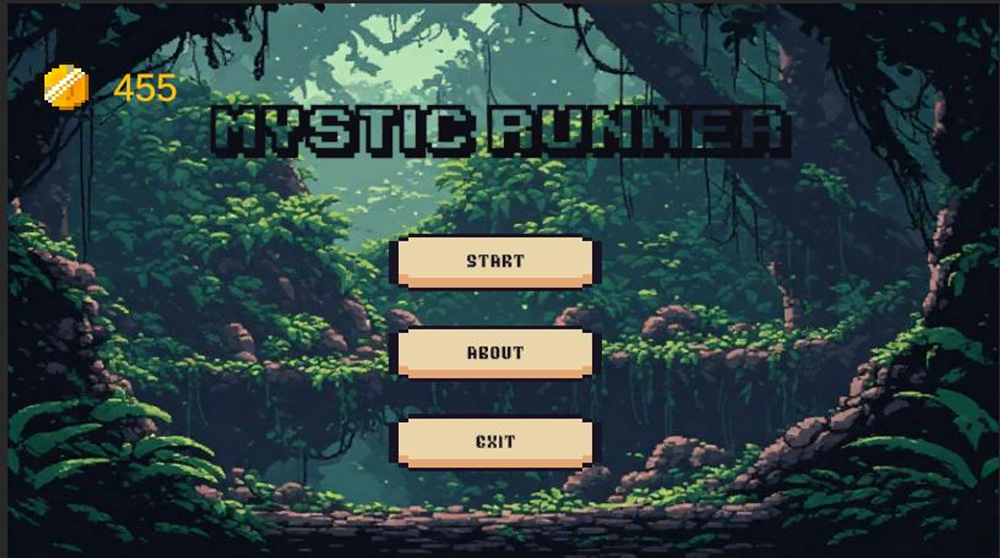
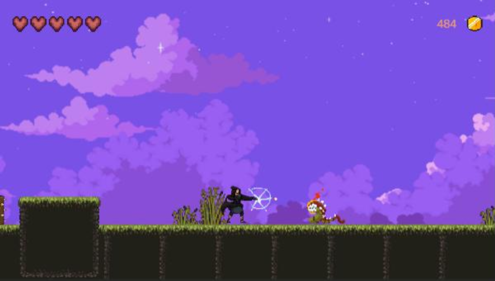
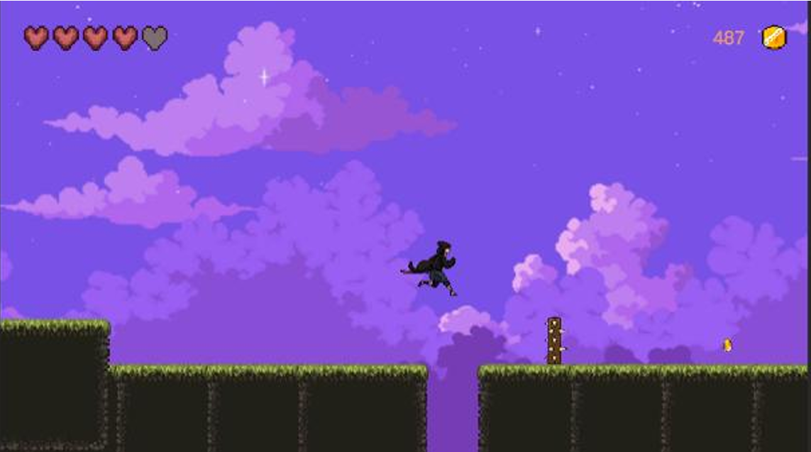
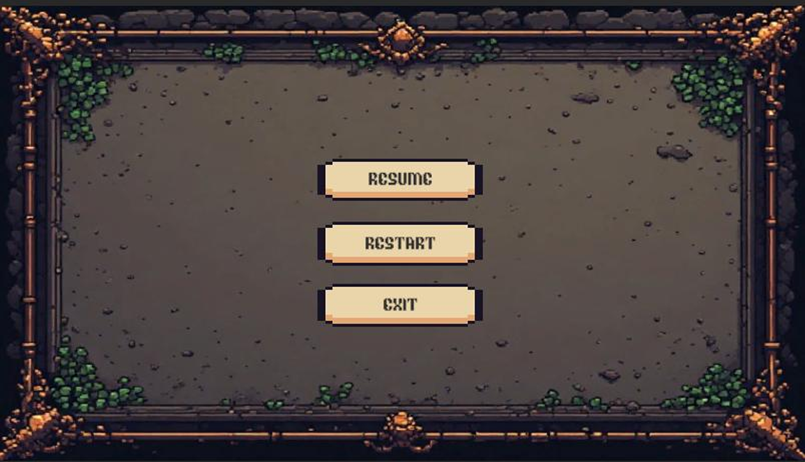

# 🧙 Mystic Runner

**Mystic Runner** is a 2D pixel art platformer developed with Unity and C#. Play as a young wizard on a dangerous journey through three challenging regions filled with enemies, traps, and obstacles. Use magical attacks to defeat enemies, collect coins and food to survive, and make your way through each level to reach the final destination: home.

🎮 **[Play Mystic Runner](https://play.unity.com/en/games/ff68aeb9-14a9-443b-aa18-39ac82482eec/final-)**

---

## 📖 About the Game

In Mystic Runner, you take control of a wizard who must travel through three dangerous regions to complete his journey and return home.

Each region presents new challenges, including hostile creatures, deadly traps, and environmental obstacles. Players must use their magical abilities, avoid hazards, and collect valuable resources to survive.

The ultimate goal is to overcome all three levels and safely reach home.

## ✨ Features

- **Pixel Art Graphics:** A 2D platforming experience with a pixel art visual style.
- **Player Animations:** Walking, running, jumping, attacking, taking damage, and death animations.
- **Magic Combat:** Cast fireballs to attack and defeat enemies.
- **Enemy AI:** Enemies patrol designated areas and respond to player attacks.
- **Health System:** Monitor player health through an in-game heart-based interface.
- **Collectibles:** Gather coins and food throughout the levels.
- **Healing System:** Collect food to restore lost health.
- **Environmental Hazards:** Avoid dangerous traps, spikes, and obstacles.
- **Level Progression:** Explore three levels and use portals to advance.
- **Persistent Coin Storage:** Save total collected coins between game sessions.
- **Game UI:** Main menu, character selection, health display, coin counter, pause menu, Game Over screen, and ending screen.
- **Audio Effects:** Background music and sound effects for gameplay interactions.

## 🎮 Controls

| Action | Key |
|---|---|
| Move Left | A |
| Move Right | D |
| Jump | Space |
| Attack | F |

## 🛠️ Built With

- **Game Engine:** Unity
- **Programming Language:** C#
- **Graphics:** 2D Pixel Art
- **UI:** Unity UI and TextMeshPro
- **Animation:** Unity Animator
- **Physics:** Unity 2D Physics
- **Data Persistence:** PlayerPrefs

## 🗺️ Game Progression

The game consists of three playable levels. Each level features its own environment, enemies, and obstacles.

Players must survive each area, collect resources, and reach the portal to proceed to the next level.

Completing the final level leads to the game's ending.

## 🚀 Getting Started

To open and run the project locally:

1. Clone the repository:

   ```bash
   git clone https://github.com/YOUR-USERNAME/YOUR-REPOSITORY.git
   ```

2. Open Unity Hub.
3. Select **Add Project from Disk**.
4. Choose the cloned project directory.
5. Open the project with the compatible Unity Editor version.
6. Open the Main Menu scene and press Play.

## 💾 Save System

Mystic Runner uses Unity's PlayerPrefs system to store the player's total coin balance locally.

Collected coins are saved and remain available across game sessions, while the coins collected during an individual run are tracked separately.

## 🖼️ Screenshots

## Screenshots

### Main Menu


### Gameplay



### Ending


## 🎓 Project Information

Mystic Runner was developed as an academic game development project to demonstrate practical skills in 2D game development, C# programming, Unity animation, collision detection, enemy behavior, UI implementation, and game state management.

## 👩‍💻 Author

Developed as a university project by Homa-mh.

